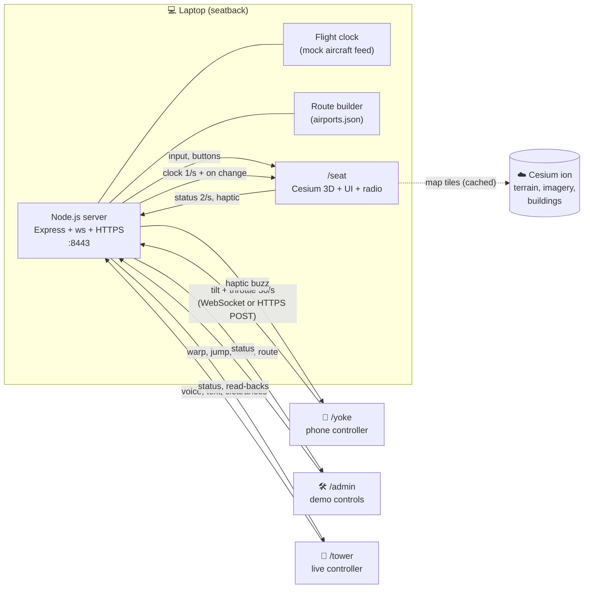
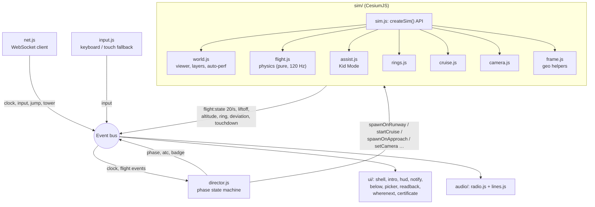
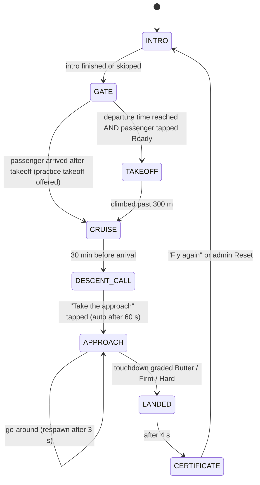
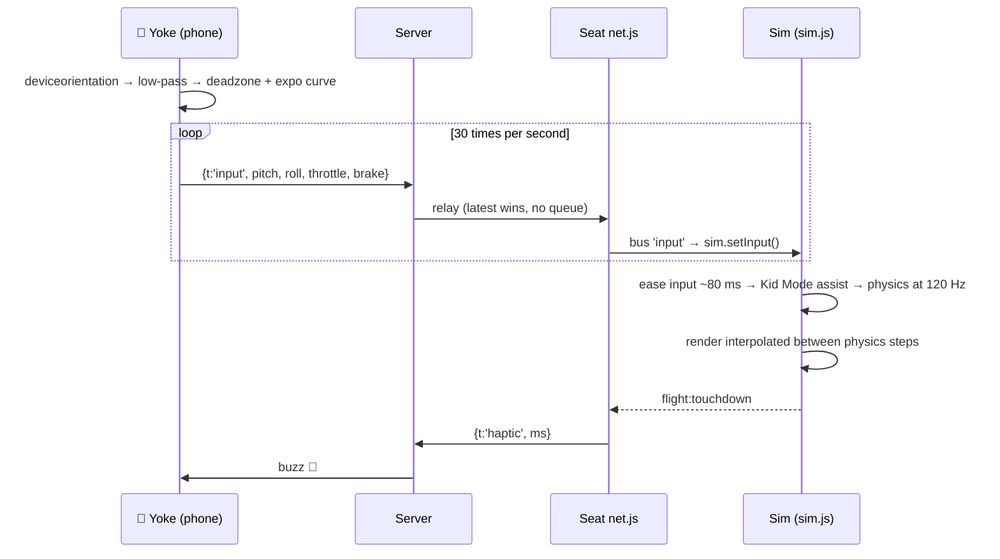

# ✈️ Valkyrie: Fly Your Flight
**A seatback in-flight entertainment experience where the passenger flies their *real* flight.** Built at Layover 2026, TinkerSpace Calicut.

You're on flight VK101 from Calicut to Dubai. The seatback screen knows where the real aircraft is, so instead of a movie you get to:
- **take off** from the real Calicut runway 28,
- **cruise** over the Arabian Sea in real time (cards point out what's below you),
- take the **landing at Dubai runway 30L**,
- earn a **pilot certificate**.

Your **phone is the yoke**. An air-traffic **control tower talks to you over the radio**, and a teammate can even talk live.

Along the way, **"Where next?" shows QR codes for The Visa Guy**, tagged as a new seatback sales channel.

---

## Contents
1. [The idea in 30 seconds](#1-the-idea-in-30-seconds)
2. [Feature overview](#2-feature-overview)
3. [Tech stack and frameworks](#3-tech-stack-and-frameworks)
4. [System architecture](#4-system-architecture)
5. [How a flight works (workflow)](#5-how-a-flight-works-workflow)
6. [Inside each part](#6-inside-each-part)
7. [Message protocol](#7-message-protocol)
8. [Project structure](#8-project-structure)
9. [Run it](#9-run-it)
10. [Demo script for judges](#10-demo-script-for-judges)
11. [Testing](#11-testing)
12. [Offline behaviour and performance](#12-offline-behaviour-and-performance)
13. [Configuration and tuning](#13-configuration-and-tuning)
14. [Known limitations](#14-known-limitations)
15. [Credits](#15-credits)

---

## 1. The idea in 30 seconds
| Problem | Our answer |
|---|---|
| Seatback screens are passive: movies and a map | An interactive experience tied to **the flight you're actually on** |
| A 4-hour flight is long | The experience follows the real flight clock: takeoff at departure time, the landing call 30 min before arrival |
| Flight sims are hard | **Kid Mode** quietly flies with you, so anyone (a 6-year-old or a judge) gets a smooth landing |
| Airlines and partners want new channels | **"Where next?"** QR codes tagged `utm_source=seatback`: a measurable channel for The Visa Guy |

---

## 2. Feature overview
| Area | What it does |
|---|---|
| **Whole-flight experience** | Intro → Gate → Takeoff → Cruise → "Approach is calling" → Approach → Landed → Certificate, driven by a server-side flight clock. A timeline bar shows the whole flight |
| **Real 3D world** | Cesium terrain, satellite imagery and OSM 3D buildings at real airports and runways. Optional Google Photorealistic 3D cities |
| **Phone yoke** | Tilt to steer (landscape "steering wheel" or portrait "tray" grip), throttle bar, brake, buttons. Buzzes on touchdown |
| **Kid Mode** | Auto-throttle, auto-rotate, glide-path and centreline hold, auto-flare, auto-brake. Lands softly even when started 150 m off the centreline |
| **Golden rings** | 8 rings on the 3° glide path; the "Ring master" badge |
| **Radio tower** | Route-aware ATC lines with a radio filter (band-pass + distortion + squelch) and subtitles |
| **Live Control Tower** (`/tower`) | A teammate talks live (push-to-talk voice goes through the radio filter), types messages, fires clearances, and records the official lines in the browser |
| **Radio read-back** | The passenger says the clearance back; speech recognition checks it ("Radio pro" badge) |
| **Cruise extras** | "What's below me" landmark cards, take the controls from the autopilot, an altitude-hold mission, a cockpit camera |
| **Fly from anywhere** | Pick any two of 3,165 airports; the server picks real runways and the whole experience adapts |
| **The Visa Guy** | "Where next?" destination cards and a certificate, each with a tagged QR code |
| **Demo Mode** (`/admin`) | Time warp 1×/60×/600×, jump to any phase, reset for the next judge, route picker, live FPS and connection health |
| **Resilience** | Tile cache for offline use, a fallback globe, a stub sim if 3D can't load, an HTTPS fallback for the iPhone yoke, IPv6-only hotspot support, automatic quality scaling |

---

## 3. Tech stack and frameworks
**Design choice: no bundler and no frontend framework.** Everything is plain HTML plus native ES modules, so any laptop runs it with only `npm install`, and anyone can read the source.

### Backend (Node.js)
| Technology | Version | Used for |
|---|---|---|
| **Node.js** | 18+ (tested on 26) | Runtime |
| **Express** | 4.x | Static file server + small REST API (`/api/info`, `/api/clips`, `/api/yoke`) |
| **ws** | 8.x | WebSocket relay between seat, yoke, admin and tower |
| **selfsigned** | 2.x | Generates an HTTPS certificate on first run. HTTPS is required for phone motion sensors and the microphone |
| **node:https / node:crypto** | built-in | HTTPS server; checks that the certificate covers the current network address |
| **node:test** | built-in | Unit tests (`npm test`) |

### Frontend (browser)
| Technology | Used for |
|---|---|
| **HTML5 + CSS3 + JavaScript (ES modules)** | All UI. No React, no build step |
| **CesiumJS 1.121** (CDN) | 3D globe, terrain, imagery, 3D buildings, aircraft model, camera |
| **Cesium ion** | Cesium World Terrain, Bing satellite imagery, OSM Buildings, Google Photorealistic 3D Tiles (optional) |
| **qrcodejs 1.0.0** (vendored in `web/vendor/`) | QR codes; works offline |
| **Web Audio API** | Radio effect chain: BiquadFilter band-pass (1.5 kHz) → WaveShaper distortion → gain, plus noise bursts |
| **Web Speech API: SpeechSynthesis** | Tower voice (text-to-speech) when no recorded clip exists |
| **Web Speech API: SpeechRecognition** | Passenger read-back check (Chrome) |
| **DeviceOrientation API** | Phone tilt → pitch/roll (asks for iOS motion permission on tap) |
| **Vibration API** | Touchdown buzz on Android |
| **MediaRecorder + getUserMedia** | Tower push-to-talk and the in-browser clip recorder |
| **Service Worker + Cache Storage** | Caches the Cesium library and map tiles for offline use |
| **Intl.DisplayNames** | Country names in the "what's below me" cards |
| **localStorage** | Saves progress, badges and Kid Mode setting per route |

### Data
| File | Source | Used for |
|---|---|---|
| `web/data/airports.json` | OurAirports (public domain), 3,165 airports | Runway thresholds (lat/lon/heading), city names, any-route picker, handoff centre |
| `web/data/landmarks.json` | Hand-written | "What's below me" facts along the route |
| `web/seat/sim/assets/plane.glb` | CesiumJS sample model (Cesium_Air) | The aircraft |

---

## 4. System architecture
One Node.js process on the laptop serves four web apps. They talk to each other through a WebSocket relay. All devices join **one phone hotspot**; the internet is needed only for map tiles, and even that can be cached.



### The seat app (where most of the logic lives)
Inside the browser, modules never call each other directly. They communicate through a tiny **event bus** (`shared/bus.js`, a wrapper around `EventTarget`). The 3D simulation sits behind a single API (`createSim`), so the experience layer never touches Cesium directly.



**Why this design:** two people could build in parallel without conflicts. One owned `sim/` (the 3D world and physics), the other owned everything else. The bus events and the `createSim` API were the agreed contract between them (`web/shared/contracts.js`).

---

## 5. How a flight works (workflow)
### 5.1 Phase state machine (`seat/director.js`)
The **server clock** says where the "real" aircraft is (`progress = (now − departure) / (arrival − departure)`). The director combines the clock, flight events and passenger taps to move between phases.



| Phase | What the sim does | What the passenger sees and hears |
|---|---|---|
| INTRO | Camera over the departure airport | Captain Vee, passport, **VISA APPROVED** stamp, boarding pass |
| GATE | Aircraft on the runway threshold | Gate screen, yoke QR, countdown, "line up and wait" |
| TAKEOFF | Free flight from the real runway | "Cleared for takeoff", read-back prompt, "Wheels up" badge |
| CRUISE | Autopilot on the great-circle route at 11,000 m, following real progress | Route line, overview swoop, landmark cards, **Where next**, "take the controls" |
| DESCENT_CALL | Still cruising | "📻 Dubai Approach is calling!" |
| APPROACH | Spawned 8 km out on a 3° glide path at Dubai 30L | Golden rings, "cleared to land", deviation calls |
| LANDED → CERTIFICATE | Orbit camera around the aircraft | Grade, stars, touchdown fpm, km flown, badges, TVG QR |

### 5.2 Input path: phone tilt to plane movement


### 5.3 Fly from anywhere
1. The passenger (seat intro → "Change flight") or an operator (`/admin`) picks two airports.
2. The server's `routes.js` picks the **runway end best aligned** with the departure direction and the final approach course, preferring long runways. It estimates block time from distance and gives the flight a flight number.
3. The clock switches route and broadcasts it, and every device follows.
4. ATC lines, city names, the handoff centre (e.g. "Muscat Control", the nearest hub airport two-thirds of the way along, outside the departure and arrival countries) and the timeline all come **from the data**. None of it is hardcoded.

---

## 6. Inside each part
### 6.1 Server (`server/`)
| File | Responsibility |
|---|---|
| `index.js` | HTTPS (or plain HTTP behind a cloud host's HTTPS in cloud mode) + Express static hosting, WebSocket relay by role (`seat`, `yoke`, `admin`, `tower`), clip upload API, HTTPS-POST yoke fallback, page-open logging, prints the device URLs |
| `clock.js` | Mock aircraft data feed: departure/arrival times, warp (virtual `now += realDt × warp`), jump-to-phase, route switching |
| `routes.js` | Any-route builder: bearings, distances, runway choice, block time |

**Networking details**
- Listens dual-stack (`::`), so it also works on **IPv6-only hotspots** (common on Jio).
- Regenerates its certificate when the laptop joins a network with a new IPv4 address.
- iPhone Safari often refuses `wss://` with a self-signed certificate even after the page warning was accepted, so the yoke automatically falls back to `POST /api/yoke` over the same HTTPS connection.

### 6.2 Simulation (`web/seat/sim/`)
| File | Responsibility |
|---|---|
| `sim.js` | The only public entry point (`createSim`). Fixed-step physics loop (120 Hz) with render interpolation, input smoothing, events to the bus |
| `world.js` | Cesium viewer and layers (NaturalEarth fallback → Bing imagery → OSM buildings), Google 3D toggle, **auto-perf quality ladder**, daylight lighting |
| `flight.js` | **Pure-math flight model** (no Cesium, so it's unit-testable): thrust, drag, gravity, pitch/roll rates, coordinated turns, stall sink, ground roll, brakes, liftoff/touchdown, landing grade |
| `assist.js` | Kid Mode: auto-throttle, auto-rotate, glide-path and centreline hold, auto-flare (−1 m/s), auto-brake, gentle limits |
| `frame.js` | Geo helpers: local East-North-Up frame at the runway threshold, **true runway bearing** from both runway ends, terrain-sampled ground heights |
| `rings.js` | 8 glide-path rings and pass/miss detection |
| `cruise.js` | Great-circle position at the clock's progress, route line, overview rectangle |
| `camera.js` | Smoothed chase camera, cockpit camera, orbit camera, overview swoop |
| `sandbox.html` | Solo test page for the sim (keyboard only) |

**Landing grade:** under 1.5 m/s sink → **Butter ★★★** · under 3 → Firm ★★ · under 5 → Hard ★ · anything harder, or landing off the runway → **Go-around** (respawn). There is never a "crash".

### 6.3 Experience (`web/seat/`)
| File | Responsibility |
|---|---|
| `main.js` | Wiring: loads airports, starts the sim (or a stub if 3D fails), the director, UI, audio, service worker, FPS and yoke-rate reporting |
| `director.js` | The brain: phase state machine, ATC triggers, badges, missions, saved progress |
| `net.js` / `input.js` | WebSocket client / keyboard and on-screen controls fallback |
| `ui/shell.js` | IFE home screen, flight card, timeline bar, gate panel with the yoke QR |
| `ui/intro.js` | Captain Vee intro animation and the "Change flight" entry |
| `ui/hud.js` | Speed, altitude, vertical speed, heading, throttle, take-controls and camera buttons, ATC subtitles |
| `ui/notify.js` | Toasts and Captain Vee speech bubbles |
| `ui/below.js` | "What's below me" landmark and nearest-city cards (with left/right side) |
| `ui/picker.js` | Any-airport search |
| `ui/readback.js` | Read-back with speech recognition and a forgiving matcher ("two eight" = "twenty eight" = 28) |
| `ui/wherenext.js` / `ui/certificate.js` | The Visa Guy destination QRs / pilot certificate |
| `audio/lines.js` | ATC line table filled from route and airport data |
| `audio/radio.js` | Radio chain; plays a recorded clip if one exists, otherwise text-to-speech; plays live tower voice |
| `sw.js` | Service worker tile cache |

### 6.4 Other apps
| App | Purpose |
|---|---|
| `web/yoke/` | Phone controller: tilt (both grips), throttle, Brake, Kid, Ready, Centre, Retry, Fly/Auto, Camera; shows connection status and errors on screen |
| `web/admin/` | Demo controls and live health: phase, FPS, quality level, yoke input rate, cached tiles |
| `web/tower/` | Live controller: flight status, push-to-talk, typed messages, clearance buttons, read-back log, clip recorder |

---

## 7. Message protocol
WebSocket envelope: JSON `{t: <type>, ...payload}`, connected via `wss://<host>/ws?role=seat|yoke|admin|tower`. Full definitions are in `web/shared/contracts.js`.

| Type | Direction | Payload |
|---|---|---|
| `input` | yoke → seat | `{pitch, roll, throttle, brake}` at about 30 Hz, latest wins |
| `button` | yoke → seat | `{id: 'kid' \| 'ready' \| 'reset' \| 'control' \| 'camera'}` |
| `clock` | server → all | `{depMs, arrMs, nowMs, warp, progress, routeId, route}` at 1 Hz and on change |
| `jump` | server → seat | `{phase}` (from admin) |
| `admin` | admin → server | `{cmd: 'warp' \| 'jump' \| 'route' \| 'customRoute' \| 'feature' \| 'reset', ...}` |
| `status` | seat → admin, tower | `{phase, state, fps, quality, yokeHz, cachedTiles, ...}` at 2 Hz |
| `haptic` | seat → yoke | `{ms}` on touchdown |
| `tower` | tower → seat | `{kind: 'line', id}` · `{kind: 'text', text}` · `{kind: 'voice', b64}` |
| `readback` | seat → tower | `{id, heard, ok}` |
| `feature`, `clips`, `routeResult` | server → seat/admin | Photoreal toggle · recorded clip list · custom route result |

**Seat-internal bus events (sim → experience):** `world:ready`, `flight:state` (20 Hz), `flight:liftoff`, `flight:altitude`, `flight:ring`, `flight:deviation`, `flight:touchdown`.

---

## 8. Project structure
```
layover/
├── server/
│   ├── index.js            HTTPS + Express + WebSocket relay + APIs
│   ├── clock.js            mock aircraft feed (warp, jump, routes)
│   └── routes.js           any-airport route builder
├── web/
│   ├── shared/             contracts.js · bus.js · config.js (token, routes, QR base)
│   ├── data/               airports.json · landmarks.json
│   ├── vendor/             qrcode.min.js
│   ├── seat/               seatback app
│   │   ├── index.html · main.js · director.js · net.js · input.js · styles.css · sw.js
│   │   ├── ui/             shell · intro · hud · notify · below · picker · readback · wherenext · certificate
│   │   ├── audio/          radio.js · lines.js · clips/ (recorded tower lines)
│   │   ├── sim/            sim · world · flight · assist · frame · rings · cruise · camera · sandbox.html · assets/plane.glb
│   │   └── img/            Captain Vee art
│   ├── yoke/               phone controller
│   ├── admin/              demo controls
│   └── tower/              live control tower
├── test/                   flight · routes · readback tests (node:test)
├── docs/                   BUILD_SPEC.md · RUNBOOK.md · MASTER_CHECKLIST.md
├── render.yaml             one-click cloud deploy (Render)
└── package.json
```

---

## 9. Run it
**Requirements:** Node.js 18+, Chrome on the laptop, any modern phone browser, and a free Cesium ion token (already set in `web/shared/config.js`).

```bash
npm install
npm test        # 11 tests should pass
npm start       # prints the links for every device
```

| Device | Open | Notes |
|---|---|---|
| 💻 Laptop (seatback) | `https://localhost:8443/seat/` | Accept the certificate warning (Advanced → Proceed). F11 for full screen |
| 📱 Phone (yoke) | Scan the QR on the gate screen, or `https://<LAN-IP>:8443/yoke/` | Accept the warning, tap **Start**, allow motion. Same hotspot as the laptop |
| 🛠 Second device | `https://<LAN-IP>:8443/admin/` | Demo controls |
| 🗼 Third device (optional) | `https://<LAN-IP>:8443/tower/` | Live controller (allow the microphone) |

**No phone?** Keyboard: W/S pitch (S = nose up) · A/D roll · Shift/Ctrl throttle · B brake · K Kid Mode · V camera · T take the controls. On-screen arrows appear after 10 s.

**Network tip:** all devices must be on the **same hotspot**. An **iPhone Personal Hotspot** is the most reliable. Some routers isolate devices from each other, and the terminal prints `[http] <address> opened /yoke/` so you can see whether the phone actually reached the laptop.

### Host it online (for mentors to try later)
The same code runs on a cloud host. Cloud mode switches on automatically there:
- the host provides HTTPS, so there are **no certificate warnings**;
- each new visitor gets a fresh flight from the gate;
- a **🛠 Demo controls** link opens `/admin` so a visitor can jump through the phases.

**Deploy on Render (free):**
1. render.com → sign in with GitHub → **New → Blueprint** → choose this repo. It reads `render.yaml`: build `npm install`, start `npm start`, env `CLOUD=1`.
2. Wait for the deploy, then open `https://<your-app>.onrender.com/seat/`.
3. On cesium.com/ion → Access Tokens, restrict the token's **allowed URLs** to your Render address (and `localhost`) so others can't reuse it.

Notes:
- The free plan sleeps when idle, so the first visit takes about 30 s.
- All visitors share one flight clock.
- Clips recorded online are lost on restart, so record them locally and commit them.

**Trying it online without a phone:** open `/seat/` and fly with the keyboard (Shift = throttle, S = pull up, A/D = turn). Open **🛠 Demo controls** in another tab to jump to Cruise → Descent call → Approach.

---

## 10. Demo script for judges
About 2 minutes: you run `/admin`, and a teammate can run `/tower`.

| # | Step | The judge experiences |
|---|---|---|
| 1 | Judge taps **Start** | Captain Vee, **VISA APPROVED**, boarding pass Calicut → Dubai |
| 2 | Point at the timeline bar | "This follows your whole 4-hour flight, synced to the aircraft" |
| 3 | Judge scans the yoke QR and taps **Ready** | Real Calicut runway, "cleared for takeoff", tilt to fly. Optional: read the clearance back |
| 4 | Admin → **CRUISE** | Overview swoop over the Arabian Sea, "Below you: Muscat" card, **Where next?** QR |
| 5 | Admin → **DESCENT CALL** | "📻 Dubai Approach is calling!" Tap to take the approach |
| 6 | Tower teammate talks live | Real voice through the radio filter |
| 7 | Rings and landing | Kid Mode guides, Butter landing, phone buzz |
| 8 | Certificate | Stars, badges, TVG QR |
| 9 | Optional closer | "Change flight": the judge's home airport |
| 10 | Admin → **Reset** | Ready for the next judge |

---

## 11. Testing
```bash
npm test
```
| Test file | What it checks |
|---|---|
| `test/flight.test.mjs` | Kid Mode takeoff lifts off within the runway and climbs past 300 m · the nose stays down below rotate speed · Kid Mode hands-off landing is soft · it lands even when started 150 m off the centreline · grading thresholds |
| `test/routes.test.mjs` | Featured routes are kept · custom routes pick real runways (e.g. Heathrow 27L/R from the east) · bad input gives an error, not a crash |
| `test/readback.test.mjs` | Read-back matching: "two eight", "twenty eight", "28", "thirty left" accepted; wrong runway rejected |

The full flow was also run end to end in headless Chrome across seat, admin, tower and yoke, with both the real Cesium sim and the offline stub.

---

## 12. Offline behaviour and performance
| Situation | What happens |
|---|---|
| No internet, hotspot on | Everything works (yoke, admin, tower, flow, radio, QR codes). The map shows from the tile cache |
| No internet and nothing cached | The seat falls back to a simple stub view; the full flow still works |
| Cesium ion unreachable | A NaturalEarth low-res globe still shows |
| Slow laptop | **Auto-perf** lowers map detail, resolution, then buildings when FPS drops below 50, and restores them when there's headroom |
| Bursty Wi-Fi | Inputs are smoothed (~80 ms) and physics frames interpolated, so motion stays smooth |

**Warm the cache:** fly the demo route 2–3 times online in the same Chrome profile. `/admin` shows the cached-tile count.

---

## 13. Configuration and tuning
| What | Where |
|---|---|
| Cesium token, callsign, featured routes, QR link and UTM tags | `web/shared/config.js` |
| Graphics quality and auto-perf | `web/seat/sim/world.js` → `PERF` |
| Flight feel | `web/seat/sim/flight.js` → `K` |
| Kid Mode assists | `web/seat/sim/assist.js` |
| Plane direction / wheel height | `web/seat/sim/sim.js` → `MODEL_HEADING_OFFSET`, `MODEL_Z_OFFSET` |
| Phone sensitivity | `web/yoke/yoke.js` → `GRIP` |
| Tower lines | `web/seat/audio/lines.js`, or record them on `/tower` |
| Landmarks | `web/data/landmarks.json` |

---

## 14. Known limitations
- The "real aircraft" is a **mock data feed** (`server/clock.js`). A real deployment would plug in the aircraft's ARINC/IFE position feed at the same interface.
- The aircraft model is Cesium's sample prop plane; an airliner `.glb` can replace `sim/assets/plane.glb`.
- Read-back needs internet (Chrome sends the audio to Google's speech service).
- Google Photorealistic 3D tiles need internet, are not cached (Google's terms), and are heavy on weak GPUs.
- The certificate is self-signed, so each device shows a one-time browser warning.

---

## 15. Credits
CesiumJS (Apache-2.0) and its sample model `Cesium_Air.glb` · Cesium World Terrain + Bing imagery via Cesium ion · Google Photorealistic 3D Tiles (optional) · OpenStreetMap buildings © OpenStreetMap contributors · Airport data: OurAirports (public domain) · qrcodejs (MIT) · Express, ws, selfsigned (MIT).

More docs: `docs/BUILD_SPEC.md` (original spec and contracts) · `docs/RUNBOOK.md` (setup) · `docs/MASTER_CHECKLIST.md` (status and to-do).
